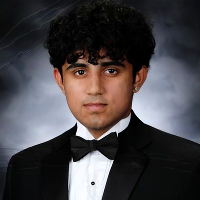
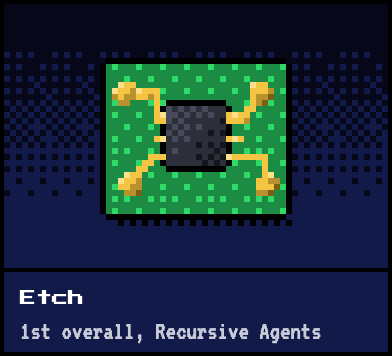
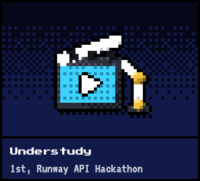
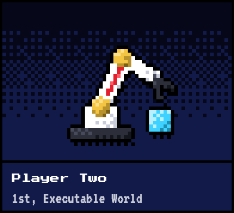
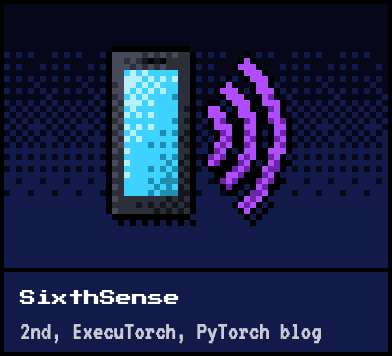
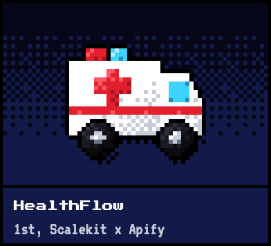
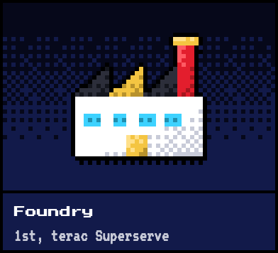

### Pranav Achar

I build AI agents and robot learning systems. Since June 2026 I've placed at eight hackathons, six of them first place. First-year at Los Angeles Mission College, transferring to a UC in fall 2027.

<a href="https://pranavachar.com">pranavachar.com</a> · <a href="https://www.linkedin.com/in/pranavachar">LinkedIn</a> · <a href="resume.pdf">Resume</a> · <a href="mailto:achar.pranav@gmail.com">achar.pranav@gmail.com</a>

 

#### Selected work

| | Project | Result | What it does |
|---|---|---|---|
|  | [Etch](https://github.com/PranavAchar01/etch) | 1st overall, Recursive Agents Hackathon ($14,000) | Agents turn a spoken request into a routed KiCad board of real parts, checked by ERC, DRC and an ngspice simulation, with up to three repair tries per board. |
|  | [Understudy](https://github.com/PranavAchar01/understudy-replay) | 1st, Runway API Hackathon ($10,000) | One sentence in, Runway-generated and physics-checked robot demos out, then a SmolVLA policy trained on them: 43/50 in simulation against 44/50 for perfect scripted demos. |
|  | [Player Two](https://github.com/PranavAchar01/player-two) | 1st, Executable World AI Hackathon | Finds Creative Commons video of people doing a task and retargets it onto Unitree G1, SO-101 and Franka Panda. One unattended run screened 68 videos in under 17 minutes. |
|  | [SixthSense](https://github.com/shanayg15/SixthSense-QualcommxMeta) | 2nd, Qualcomm x Meta ExecuTorch Hackathon | Offline navigation copilot for blind users on a Galaxy S25. Featured on the [PyTorch Foundation blog](https://pytorch.org/blog/building-the-future-of-on-device-ai-at-the-executorch-hackathon/). |
|  | [HealthFlow](https://github.com/PranavAchar01/HealthFlow-ApifyxScalekit) | 1st, Scalekit x Apify Hackathon | A 9-agent pipeline from paramedic voice notes to an EHR entry. |
|  | [Foundry](https://github.com/PranavAchar01/foundry) | 1st, Superserve track, terac One-Person-Company Hackathon | An agent that builds a storefront per person. |

#### Research and open source

- **UC Santa Cruz AIEA Lab**, AI research intern. Multi-step reasoning in small LLMs: 63 to 72% of wrong GSM8K answers had correct arithmetic on the wrong plan. Preprint (not peer-reviewed): [Where Multi-Step Reasoning Breaks](https://zenodo.org/records/23329497).
- **statsmodels**: 11 bug fixes, two for issues open since 2018, plus GLM documentation.
- **Vision-language models** for on-device event monitoring (independent research). A pose-based prototype flagged all 14 scored falls on the UR Fall benchmark, a median 2.6 s after onset.

#### Tools

Python, PyTorch, ExecuTorch, MuJoCo, LeRobot, MediaPipe, ONNX, TypeScript, Next.js, React, Postgres, Docker, Claude and other LLM APIs.
