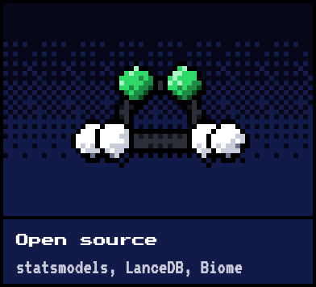
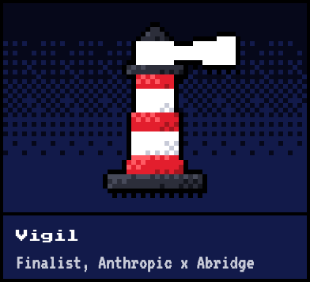

### I try to build cool things.

 

<a href="https://github.com/PranavAchar01/PranavAchar01/blob/main/resume.pdf">Resume</a> · <a href="https://pranavachar.vercel.app">Website</a> · <a href="https://www.linkedin.com/in/pranavachar">LinkedIn</a>

