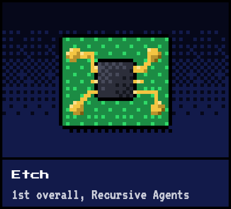
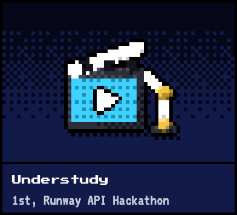
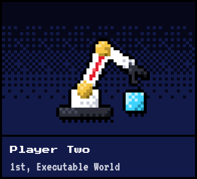
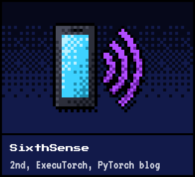
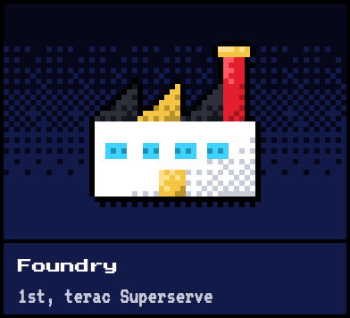
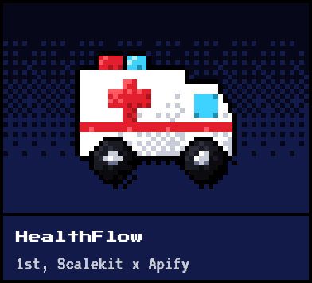

### Pranav Achar

AI and robotics engineer, CS and math student in the Bay Area. I build robot learning systems, computer vision pipelines and LLM agents, mostly at hackathons. Open source contributor to statsmodels, LanceDB and Biome.

Skills: Python, TypeScript, PyTorch, MuJoCo, LeRobot, MediaPipe, YOLO, computer vision, robot learning, LLM agents, Claude API, LangGraph, Next.js, React, Postgres, Docker

 

 

#### Hackathon wins

- 1st overall, Recursive Agents Hackathon, $14K. [Etch](https://github.com/PranavAchar01/etch): describe a circuit board and an agent picks real KiCad parts, routes the board and checks it with ERC, DRC and ngspice.
- 1st place, Runway API Hackathon, $10K. [Understudy](https://github.com/PranavAchar01/understudy-replay) turns one sentence into Runway-generated, physics-checked robot demonstrations and trains a SmolVLA policy on them, in simulation.
- 1st place, Track 1, The Executable World. [Player Two](https://github.com/PranavAchar01/player-two) turns one sentence into physics-checked robot demonstrations with MuJoCo, MediaPipe and LeRobot.
- 1st place, Scalekit x Apify ([HealthFlow](https://github.com/PranavAchar01/HealthFlow-ApifyxScalekit))
- 1st place, Apify track, Build Club Gemini x Exa
- 1st place, Superserve track, terac One-Person-Company ([Foundry](https://github.com/PranavAchar01/foundry))
- 2nd place, Battle of the Personal Brains ([Player Two](https://github.com/PranavAchar01/Battle-of-the-Personal-Brains_player-2))
- 2nd place, Qualcomm x Meta ExecuTorch ([SixthSense](https://github.com/shanayg15/SixthSense-QualcommxMeta), an on-device navigation aid for blind users, featured on the PyTorch blog)

<a href="https://github.com/PranavAchar01/PranavAchar01/blob/main/resume.pdf">Resume</a> · <a href="https://pranavachar.com">pranavachar.com</a> · <a href="https://www.linkedin.com/in/pranavachar">LinkedIn</a>

